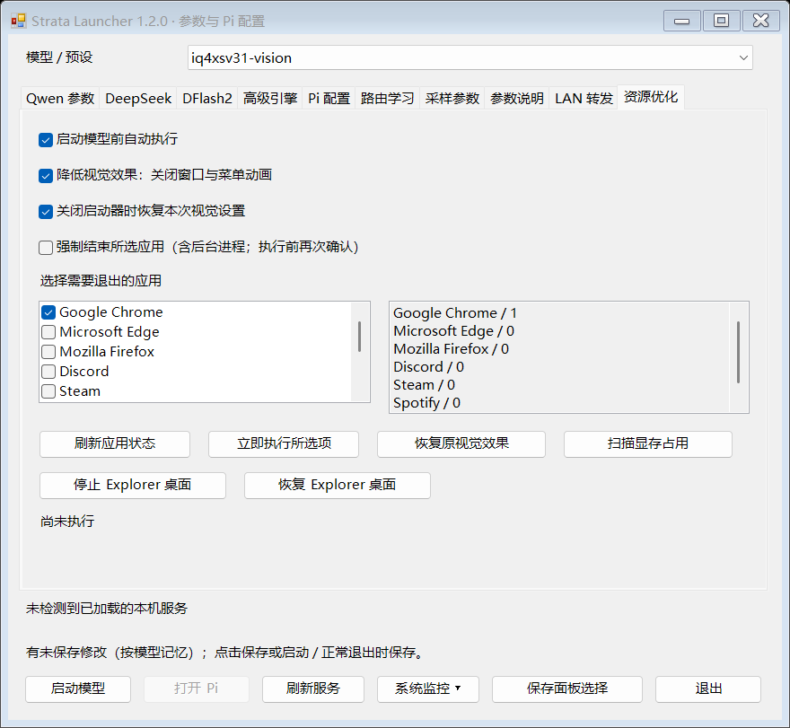

# Strata Launcher 1.3.0

[English](README.md) | [简体中文](README.zh-CN.md)

A portable Windows GUI and JSON-configured CLI for [Strata](https://github.com/Niko1221/Strata). Tune model profiles, inspect VRAM, close selected apps, view terminal telemetry, configure an existing Pi, and share inference/capabilities over a trusted private LAN.

This is an independent launcher, **not Strata Desktop**, an engine distribution, or a model downloader. Version 1.3.0 adds a dependency-free local web console on top of 1.2.0; behaviour of every existing command is unchanged.

**New installation?** [Configure your existing Strata setup](#quick-start), then choose the [Windows panel](#windows-panel) for tuning, Pi and resource controls, or the [web console](#web-console) for checks, starting and stopping configured models, and run status.

## RTX 5070 + 64 GB: My Current Best Setup

**The included IQ4_XS-v31 preset is the best configuration I have tuned so far for my own RTX 5070 12 GB + 64 GB machine and workloads.** It is not a universal optimum.

I have observed **100+ tokens/s in some workloads when the VRAM expert cache is doing the work**. Breaking 100 on a single 5070 plus 64 GB feels fast. This is an **author-reported usage observation**, not a reproducible benchmark published with this release, a sustained-speed guarantee, GPU utilization, or draft acceptance percentage. Prompt length, cache hits, drafting acceptance, output type and background GPU usage matter. No new throughput benchmark was run to publish this launcher.

[Exact preset](conf/presets/rtx5070-64g.iq4-xs-v31.json) · [Tuning notes and trade-offs](docs/RTX5070-64G.zh-CN.md)

| Saved setting | Value |
|---|---|
| Model | Qwen3.8-Flash-Next / Unsloth UD-IQ4_XS v3.1, vision |
| Strata / engine | Terminal 0.2.14 / CUDA13 engine 0.1.60 |
| Context / GPU KV | 131072 / 28672 tokens, k8v4 |
| Expert RAM / headroom | 44 / 6 GiB |
| VRAM reserve / CPU workers | 168 MiB / 5 |
| Drafting | tuned DFlash2, auto, confidence 0.8 |
| Output / thinking | 14336 / 3072, medium |

168 MiB is an aggressive user reserve, not the total driver/engine reserve. Lower the RAM budget or increase VRAM reserve when needed. `kvGrow=on` is a request and can be disabled by the engine with KV streaming. Saved manual window 4 is inactive in auto mode. Inherited tail skip is **not** proof of full-expert/lossless inference.

## Web Console

After configuring private `conf/launcher.json`, open PowerShell in the launcher folder:

```powershell
node launcher.mjs webpanel
```

1. Open the printed URL (default: [http://127.0.0.1:8444/](http://127.0.0.1:8444/)). Use the exact `127.0.0.1` address, not `localhost` or a LAN IP. If 8444 is taken, run `node launcher.mjs webpanel 8445` and use that URL instead.
2. Review the environment report, select a model profile, run **Check**, then press **Start**. Wait for the run to show ready and report its model API URL. The web port is not the inference API or LAN bridge port.
3. **You can close the browser** without stopping inference. Leave the `webpanel` terminal running. To shut it down, stop your model in the page first, then press `Ctrl+C` in that terminal.

The console listens on loopback only and does not launch models automatically. For full parameter editing, Pi and resource controls, use the native panel or the relevant CLI commands. Remote inference uses the separate LAN bridge below.

## Windows Panel

Configure `conf/launcher.json` as below. With Git for Windows and Node.js 22+ installed, double-click **`Strata-Panel.cmd`** or run `npm run panel` from the launcher folder. This is Windows PowerShell/WinForms; it does not start a browser, WebView, or web server.

Select the model/preset at the top. The model tab groups context, resources, generation and vision. The advanced engine tab includes a filter, a next-launch preview and a read-only reference. Save the panel to persist settings and click Start to load the model; Refresh only reads service status.



- Almost all everyday tuning is exposed: context, KV, RAM/VRAM, CPU, sampling, thinking, MTP/DFlash2, routing learning, plus **42 curated advanced controls** and a **162-entry engine reference**. Protected engine flags are deliberately read-only, not arbitrary command injection.
- **VRAM scan works**: NVML whole-card totals plus per-process WDDM counters (>10 MiB), separated by adapter identity. Counters can be inaccurate/shared and must not be summed into whole-card usage.
- **Selected-process termination works**: normal close by default; optional confirmed force-close of exact allowlisted PID/start-time/path/user/session targets, including the WeType updater. Unknown processes, DWM, model/Pi and generic WebView2 are not mass-killed.
- Separate **stop/restore Explorer desktop** buttons. Normal panel exit attempts owned desktop recovery; crash recovery is Task Manager (`Ctrl+Shift+Esc`) → Run new task → `explorer.exe`. File operations can be interrupted. It does not disable Windows auto-restart, updates, services or scheduled tasks.
- The old visual-recovery-journal bug is fixed: an earlier panel's journal is preserved and visual changes skipped, rather than blocking an independent confirmed app close. Failed closes show errors and prevent automatic model loading.
- GUI and CLI share model settings in private `conf/launcher.json`, with validation/backups. Resource selections and Pi UI choices remain private runtime state. No actual cleaning or desktop stop was performed by release self-tests.

For Pi, copy `conf/pi.example.json` to private `conf/pi.json`, set the installed Pi entry script and optional existing extension/skill paths. Nothing is installed or copied from another user's Pi. The panel verifies actual context, vision and model alias before opening Pi; generation/compaction behavior of your external plugins remains their responsibility. The public adapter uses Pi's CLI/extension API, not the author's private Pi internals; live Pi integration must be tested on your installed version.

## What's New

- **Windows GUI, process management and VRAM inspection**, plus the author's current 5070/64GB preset; **42 engine controls / 162 reference entries**, including `auto:8192` prefill.
- `options` shows allowed choices and effective/inherited values. `set` validates edits, backs up the original config and saves for the **next launch**, without changing a running model.
- Read-only **terminal monitoring**, locally or on another machine with Node.js. No browser or Python required on the monitoring client.
- Opt-in **LAN forwarding**, live `/capabilities` discovery and a hash-verifiable downloadable terminal client. Exact source-IP allowlist; no model-management routes.
- Config format stays `version: 1`; existing profiles do not need new fields. See [CHANGELOG.md](CHANGELOG.md).

## Requirements

- Model host: Windows, Node.js **22+**, an existing Strata Control installation with `python/python.exe` and `psutil`, and a matching engine installation.
- An existing compatible Strata model profile JSON containing its `args` array, pack, native weights, expert routing table, tokenizer, and optional vision head.
- Extended controls target engine **0.1.59, 0.1.60 and 0.1.62**. Engine and Terminal versions are **not interchangeable**. After a Strata update, check that the private config still points to an installed Control/engine pair; run `doctor` to diagnose stale paths.

No dependencies are installed into your Strata runtime. This release does not add a DeepSeek-specific, Basalt, or arbitrary GGUF backend. A model name alone is not proof of compatibility.

## Quick Start

1. Download and fully extract the ZIP from the [GitHub repository](https://github.com/dongzn2017/strata-launcher), or clone it with Git. Do not download just the `.cmd` file.
2. Open PowerShell in the launcher folder. Check that `node --version` is 22 or newer. No `npm install` is required. Install Strata and its matching engine and prepare the model separately.
3. Locate your existing install by replacing these sample folders with your own:

```powershell
node launcher.mjs detect "C:/Strata" "D:/Models"
```

`detect` does not save or launch anything. Put only the returned **`config` object** in `conf/launcher.json`, not the whole report. Alternatively, adapt [conf/launcher.example.json](conf/launcher.example.json). Check the Control/engine pairing and model-profile path; replace the placeholders and `null` values, especially `minimumFreeGiB`.

Paths in launcher config are relative to that config file; asset paths inside the original Strata model profile must be absolute. Keep private `conf/launcher.json` out of Git.

```powershell
node launcher.mjs list
node launcher.mjs doctor my-model
node launcher.mjs check my-model
```

Replace `my-model` with an actual ID from `list`. For a failed check, look for a missing private config, stale engine paths, missing model assets, a busy port or insufficient free RAM in the diagnosis. Do not clear locks or bypass memory safeguards to force startup. When the checks pass, choose a GUI above, or use the CLI:

```powershell
node launcher.mjs prepare my-model
node launcher.mjs start my-model
```

`check` is offline and read-only. `prepare` writes an isolated run manifest without starting an engine. `start` runs in the foreground, printing the `RUN_ID`, log path and loopback API URL. Use another terminal:

```powershell
node launcher.mjs status RUN_ID
node launcher.mjs stop RUN_ID
```

Replace `RUN_ID` with the returned UUID. Stop uses an ownership-token request; it does not kill an unrelated model or guess a PID. Status is a recorded snapshot, not proof that a crashed process is still alive. Readiness is not a generation-quality test.

## Tune and Save

```powershell
node launcher.mjs options
node launcher.mjs options my-model
node launcher.mjs set my-model settings.context 131072
node launcher.mjs set my-model settings.kv k8v4
node launcher.mjs set my-model settings.kvResident 16384
node launcher.mjs set my-model sampling.mode custom
node launcher.mjs set my-model sampling.temperature 0.7
node launcher.mjs set my-model engineOptions.tailSkip 0
node launcher.mjs set my-model learning.enabled true
```

Only supported `section.field` settings may be edited; `set` cannot change deployment paths or model identity. A rejected edit leaves the config unchanged. Successful edits return a backup path under `logs/config-backups`; the original Strata profile and installed files are untouched. Existing runs must be stopped and relaunched **explicitly** for changes to take effect.

See [Parameter Guide](docs/PARAMETERS.md) / [参数说明](docs/PARAMETERS.zh-CN.md), the [JSON schema](conf/launcher.schema.json), and `options` for values, units, risks and inheritance. `default` means **inherit**, not disabled. Resource limits are validation ranges, not guaranteed physical memory. A zero VRAM reserve does not bypass Windows WDDM or guarantee full VRAM allocation.

For DFlash2, set `settings.drafting` to `dflash2`; stock and tuned drafter packs are distinct. A tuned pack requires explicit `dflash2` model/quant/engine compatibility metadata and the actual pack file. The launcher never infers that compatibility from a filename. Thinking effort is independent of temperature and drafter selection.

## Terminal Monitoring

```powershell
node launcher.mjs monitor my-model
node launcher.mjs monitor my-model --once
node launcher.mjs monitor --url http://192.168.1.10:8081
```

Interactive mode shows TG/PP, GPU/VRAM, RAM/CPU, system-wide disk traffic, context, cache/drafter information when reported, and recent request metadata. Press **q** or **Ctrl+C** to leave the monitor, without stopping the model. Missing values display `--`; unavailable or stale telemetry is not presented as live. Monitoring sends only `GET /metrics`.

`monitor --once` emits JSON for scripts. Interactive monitoring needs a TTY. It is a lightweight client, **not the full upstream Strata TUI**; it does not weaken upstream monitor transport requirements.

## Private LAN and Remote Pi

The model stays bound to `127.0.0.1`. Forwarding is a separate foreground process and is disabled unless a `lan` block is configured and `lan` is explicitly started. For example, replace these sample addresses with your own:

```json
"lan": {
  "host": "192.168.1.10",
  "port": 8081,
  "allowedClients": ["127.0.0.1", "192.168.1.20"]
}
```

`host` must be an actual private/loopback IPv4 address on the server, not `0.0.0.0`. `allowedClients` accepts exact private/loopback IPv4 addresses only, not wildcards or subnets. The shipped example binds loopback only.

```powershell
node launcher.mjs lan-plan my-model
node launcher.mjs lan my-model
node launcher.mjs lan-status LAN_ID
node launcher.mjs lan-stop LAN_ID
```

`lan-plan` starts nothing. `lan` returns its separate `LAN_ID`, endpoint URLs and client SHA-256. Stop the bridge with its ID or Ctrl+C; the model keeps running. A bridge is tied to the selected model identity; rediscover after changing settings or restarting with a different model.

The server administrator must allow the selected TCP port **only from the intended client IPs**, on the Private network profile. The launcher does not create firewall rules or scheduled tasks. The client needs outbound access, not its own inbound listening port. Binding an address alone does not bypass Windows Firewall.

### Connection Discovery

Fetch `GET /capabilities` on connection. It checks live `/health`, `/props` and `/v1/models`, and returns the API model ID, canonical server model, actual context, image modality, advertised tools, generation defaults, fingerprint and Pi configuration hints. Matching hash-bound launcher settings can supply reasoning defaults; otherwise those fields are `null`, not guessed. A changed/unavailable model returns `503`.

Use the returned model ID and context, not a hard-coded name or old config. Tool support is **server-advertised**, not a real tool-call test. This launcher does not install/configure Pi or migrate sessions, plugins and watchdog budgets.

Allowed routes:

| Method | Routes |
|---|---|
| GET | `/capabilities`, `/health`, `/props`, `/metrics`, `/v1/models`, `/v1/status`, `/v1/telemetry`, `/monitor-client.mjs` |
| POST | `/v1/chat/completions`, `/v1/completions`, `/v1/messages` |

Inference bodies must be JSON; streaming is forwarded without buffering. Load/unload, configuration, request-body logs and other management endpoints are not exposed. Access logs record time, IP, method and route, not prompts or answers; engine-local logging is governed separately by Strata.

### Remote Terminal Client

On the client machine, Node.js 22+ is sufficient:

```powershell
curl.exe --fail --noproxy "*" http://192.168.1.10:8081/monitor-client.mjs --output strata-monitor.mjs
Get-FileHash .\strata-monitor.mjs -Algorithm SHA256
node strata-monitor.mjs --url http://192.168.1.10:8081
```

Compare the hash with the **trusted server-side** `lan-plan`/`lan` result before executing the downloaded file. The standalone client also supports `--once` (text snapshot) and `--interval 2` (2-30 seconds). It can be copied separately; no local Strata install is needed.

**Security boundary:** this bridge uses unencrypted HTTP, with IP filtering but **no TLS or API authentication**. It is for trusted private networks only. Never expose it to the internet or port-forward it on a router. Use a separately secured TLS/VPN/tunnel solution when network trust is insufficient. A checksum received over the same untrusted HTTP connection is not authentication.

## Tests and Release Scope

```powershell
npm run schema:check
npm test
npm run test:python
```

Python runner tests require a separate test interpreter with `psutil` (`python -m pip install psutil==7.2.2`); do not install it into someone else's Strata runtime to make tests pass. Tests use temporary files, fake assets/processes and bounded **loopback mock HTTP**. They need no GPU, weights, external API or model downloads.

v1.2.0 validation: Node/Python offline tests, schema verification, read-only real VRAM inspection and Windows GUI/resource tests at 100/125/150/200% scaling. A single real WeType updater PID was successfully terminated during the local bug fix, not by release self-tests. Explorer termination is covered with mocks, not a destructive desktop test. Throughput, live public-Pi integration and cross-machine firewall connectivity were **not** retested for this release. Start with `doctor`, `check` and a reviewed short workload on your installation.

See [AGENTS.md](AGENTS.md) for automation, [CHANGELOG.md](CHANGELOG.md) for compatibility notes and [LICENSE](LICENSE) for reuse terms. Strata's own license applies separately; no vendor binaries or weights are distributed here.
