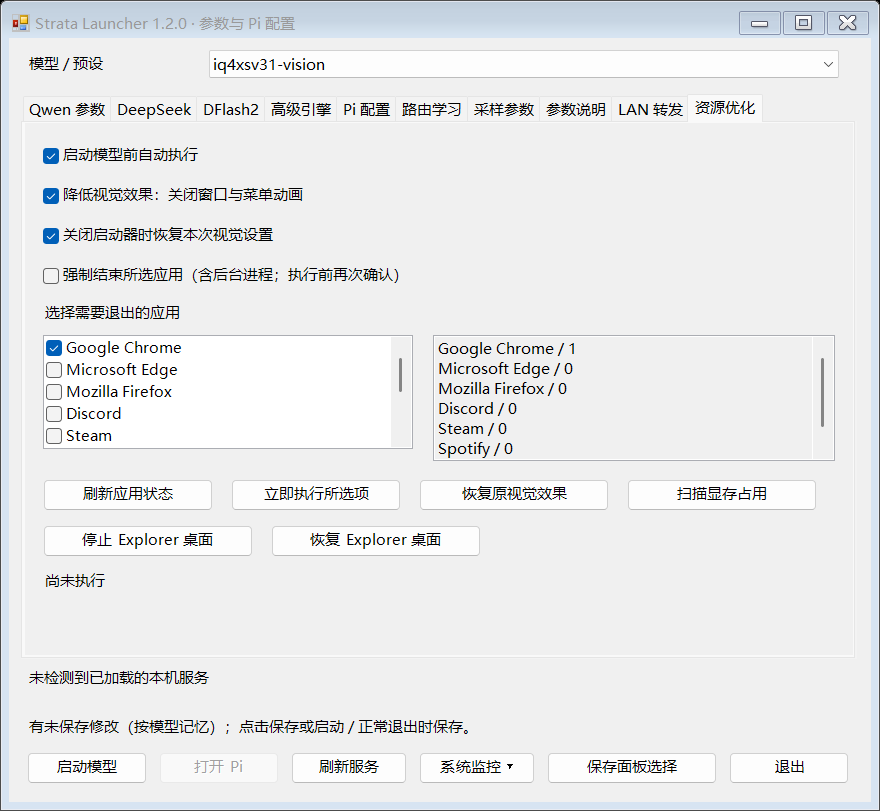

# Strata 启动器 1.3.1

[English](README.md) | [简体中文](README.zh-CN.md)

**[下载 Windows ZIP](https://github.com/dongzn2017/strata-launcher/releases/download/v1.3.1/strata-launcher-v1.3.1-windows.zip)** · [发布说明与 SHA-256 校验](https://github.com/dongzn2017/strata-launcher/releases/tag/v1.3.1) · [快速开始](#快速开始)

用 Windows 图形面板、网页或 CLI 启动和调节已有的 [Strata](https://github.com/Niko1221/Strata)。这是独立便携工具，不是 Strata Desktop；不附带引擎、模型权重、私人配置、Pi 会话或凭据。

**1.3.1 新版**支持目录形式的 MTP 运行包。网页可查模型资源，CLI 可查询下载计划并按需下载。先完成[首次配置](#快速开始)，再用以下任一入口：

| 入口 | 启动方式 | 适用场景 |
|---|---|---|
| [原生 Windows 面板](#windows-图形启动器) | 双击 `Strata-Panel.cmd` | 调参、Pi、显存检查和资源管理，无需浏览器 |
| [网页控制台](#网页控制台) | `node launcher.mjs webpanel` | 在浏览器调参、启停、看运行状态 |
| [命令行](#调参并保存) | `node launcher.mjs --help` | 脚本、配置检查和终端操作 |

## 单卡 5070 + 64GB：发布附带的自用配置快照

下方是作者在 RTX 5070 12GB + 64GB RAM 上调出的自用配置快照，**不是 1.3.0 的强制默认值，也不是所有机器的最优设置**。

显存专家工作时，我观察到过 **100+ token/s**。单卡 5070 加 64GB 能破百，还是相当快的。这里是**作者使用体验**，不是本次发布重新跑出的可复现 benchmark，不保证全程/所有上下文破百，也不是 GPU 利用率或草稿接受率。速度取决于任务、专家缓存、草稿接受情况、上下文和后台占用。

- 模型：Unsloth Qwen3.8-Flash-Next **UD-IQ4_XS v3.1 / Vision**。
- Terminal 0.2.14 / CUDA13 engine 0.1.60。
- **128K context、k8v4、28K GPU KV、44 GiB 专家 RAM、6 GiB headroom**。
- **5 CPU workers、168 MiB 显存预留、tuned DFlash2 自动模式**。
- 总输出 14336、思考 3072、medium；路由学习每 5 分钟保存。

[完整配置快照](conf/presets/rtx5070-64g.iq4-xs-v31.json) · [配置说明、套用方法与限制](docs/RTX5070-64G.zh-CN.md)

168 MiB 很激进，不是全部驱动/引擎余量；照抄不稳定时应增加余量或降低 RAM。`kvGrow=on` 只是请求，KV streaming 时引擎可能关闭；auto 模式下保存的手动窗口 4 不代表实际窗口。tail skip 继承默认，不等于强制关闭或无损推理。

## 网页控制台

配置好私有 `conf/launcher.json` 后，在启动器目录打开 PowerShell：

```powershell
node launcher.mjs webpanel
```

1. 打开终端打印的地址，默认是 [http://127.0.0.1:8444/](http://127.0.0.1:8444/)。请用 `127.0.0.1`，不要换成 `localhost` 或局域网 IP。8444 被占用时，执行 `node launcher.mjs webpanel 8445` 并打开新地址。
2. 查看**环境**，在**模型配置**选档，先点**检查**，再点**启动**。等**运行状态**显示就绪并给出模型 API 地址。网页端口不是模型 API 端口，也不是 LAN 转发端口。
3. **Chrome 可以关**：只关网页或整个浏览器不会停止推理，保留运行 `webpanel` 的终端即可。要结束网页模式，先在页面停止本轮模型，再到 Web 服务终端按 `Ctrl+C`。

在模型卡片点**调参**，可以改上下文、KV、RAM/显存、CPU、思考与采样、草稿器、路由学习和高级引擎选项。**保存参数**整批校验并备份到 `logs/config-backups`，写入与原生面板、CLI 共用的 `conf/launcher.json`。只影响下一次启动，不会停止或重启正在运行的模型。若别的窗口改了配置，请先**重新读取**。升级启动器代码后，需重开网页服务，单靠刷新浏览器不会更新后端。

网页只监听本机，不会自动加载模型，也不提供 Pi、资源优化、安装路径修改或 LAN 管理。远程推理用下方独立的 LAN 转发。

| 地址用途 | 常见端口 | 谁可以访问 |
|---|---|---|
| 网页控制台 | `8444`，可在命令末尾指定其他端口 | 仅运行启动器的本机 |
| 模型 API | `settings.port`，例如 `8080` | 本机应用或本机转发进程 |
| LAN 推理转发 | `lan.port`，例如 `8081` | 手动启用后，指定的私有客户端 IP |

同一个模型档建议只在一处编辑；网页保存后，已打开的原生窗口要先处理未保存修改，再重新打开读取新值。

## Windows 图形启动器

配置好私有 `conf/launcher.json`，安装 Git for Windows、Node.js 22+ 后，双击 **`Strata-Panel.cmd`**，或在仓库目录执行 `npm run panel`。运行的是 Windows PowerShell/WinForms，不会启动 Chrome、WebView 或网页服务。

顶部选**模型 / 预设**；模型页按上下文、资源、生成和视觉分区。**高级引擎**可筛选参数、预览下次启动覆盖值、查阅只读索引。底部**保存面板选择**保存本次设置，**启动模型**才会加载模型，**刷新服务**只重新读取状态。



- **几乎所有常用参数都可调**：上下文、KV、RAM/VRAM、CPU、采样、思考、MTP/DFlash2、学习，以及 **42 项高级控制 / 162 项参数参考**。路径、生命周期和受保护引擎参数不开放任意透传。
- **查显存可用**：NVML 整卡数值 + WDDM 进程专用显存计数，按显卡标识分开。计数可能有共享归属/误差，不能直接相加当整卡占用。
- **杀所选进程可用**：默认正常退出；另勾强制模式才纳入后台并再次确认，按 PID、启动时间、路径、用户、会话校验。含微信输入法更新器，但不批量杀输入法主体、DWM、模型、Pi 或通用 WebView2。
- 独立 **停止 / 恢复 Explorer 桌面**。正常关闭时尝试恢复本窗口停止的桌面；崩溃时用 Ctrl+Shift+Esc → 运行新任务 → `explorer.exe`。可能中断文件操作，不阻止系统自动拉起，不永久禁用更新/服务/任务。
- 已修复“旧视觉恢复记录导致已确认的结束操作没有执行”：保留旧记录、跳过视觉调整，不再挡住关闭应用。逐 PID 显示具体错误，关闭失败会阻止本次自动加载模型。
- GUI 与 CLI 共用 `conf/launcher.json` 模型参数，保存校验并备份；界面选择、会话和日志只留本机。保存不自动重启当前模型。

Pi 为可选项：将 `conf/pi.example.json` 复制为私有 `conf/pi.json`，填写自己安装的 Pi 入口和已有扩展/技能路径。按实际模型、上下文、视觉和 alias 校验后启动；不安装插件、不复制作者私有 Pi 内部代码，不迁移会话或重置 watchdog 预算。外部扩展的监视、压缩和技能行为仍由其自身负责；请在自己 Pi 版本上做真实联调。

## 保留的功能

- **图形启动器、显存扫描、进程管理、自用配置快照**；42 项可调引擎控制和 162 项参考索引，新增 `auto:8192` 分块选择。
- `options` 查看选项、范围和继承值；`set` 校验、备份并保存到配置，**下次启动生效**，不修改正在运行的模型。
- 本机和远程的**纯终端监控**，不用浏览器；监控客户端只需要 Node.js。
- 独立的 **LAN 转发**、实时 `/capabilities`、可下载且可校验哈希的终端客户端；精确来源 IP 白名单，不开放模型管理接口。
- 配置格式继续使用 `version: 1`，旧配置无需补入新字段。详见 [更新记录](CHANGELOG.md)。

## 前置条件

- 模型主机：Windows、Node.js **22+**、已有的 Strata Control 和匹配引擎；Control 的 `python/python.exe` 能导入 `psutil`。
- 已有且兼容的 Strata 模型档 JSON，包含 `args`、pack、native 权重、专家路由表、tokenizer，以及可选的视觉头。
- 高级控制适配 **引擎 0.1.59、0.1.60、0.1.62**。引擎与 Terminal 版本号不可互换。Strata 升级后，运行 `doctor` 检查私有配置是否还指向已被清理的旧组件。

本仓库不往 Strata 运行时里自动安装依赖，不新增 DeepSeek 专用后端、Basalt 后端或任意 GGUF 通用加载器。不能只凭模型名字就认为兼容。

## 快速开始

1. 从 [Release 页面](https://github.com/dongzn2017/strata-launcher/releases/tag/v1.3.1) 下载 `strata-launcher-v1.3.1-windows.zip` 并完整解压。不要只下载一个 `.cmd`。可用 `Get-FileHash .\strata-launcher-v1.3.1-windows.zip -Algorithm SHA256` 与该页的 `SHA256SUMS.txt` 比对。
2. 在解压后的启动器目录打开 PowerShell，确认 `node --version` 为 22 或以上。本启动器无需 `npm install`；Strata、匹配的引擎和已准备好的模型需事先安装。
3. 用下面的命令检查已有安装，把示例目录替换为自己的 Strata 和模型目录：

```powershell
node launcher.mjs detect "C:/Strata" "D:/Models"
```

`detect` 只输出候选，不会保存或启动。只取输出里的 **`config` 对象**作为 `conf/launcher.json` 的内容，不要整份输出写入。也可以复制 [示例配置](conf/launcher.example.json) 来编辑。核对 Control/引擎配对、模型档路径，替换占位值，尤其是启动前空闲 RAM 门槛 `minimumFreeGiB`。

启动器配置内的相对路径按配置文件目录解析；原 Strata 模型档中的资产路径要求绝对路径。私人 `conf/launcher.json` 不要提交到 Git。

**从 1.3.0 或 1.2.0 升级**时，先保留原目录，把新版解压到新目录，再复用自己的 `conf/launcher.json`（用 Pi 则也复用 `conf/pi.json`）。配置格式仍是 `version: 1`；核对指向旧目录的相对路径。不要覆盖仍在托管运行任务的旧程序，旧日志和运行清单留在原处。

```powershell
node launcher.mjs list
node launcher.mjs doctor my-model
node launcher.mjs check my-model
```

用 `list` 输出中的实际 ID 替换 `my-model`。检查失败先看 `doctor` 报告：常见原因是未创建私有配置、升级后仍指向旧引擎、模型资产缺失、端口占用或可用内存不足。不要为了通过检查去清锁或者忽略内存门槛。通过后选择上方 GUI，也可以继续用 CLI：

```powershell
node launcher.mjs prepare my-model
node launcher.mjs start my-model
```

`check` 完全离线、只读；`prepare` 写入隔离的运行清单，不启动模型；`start` 前台运行，输出 `RUN_ID`、日志和 loopback API 地址。另开终端操作：

```powershell
node launcher.mjs status RUN_ID
node launcher.mjs stop RUN_ID
```

把 `RUN_ID` 换成返回的 UUID。停止操作使用本次运行的所有权令牌，不猜 PID、不结束别人的模型。状态文件只是记录快照，进程异常退出后不能仅凭旧状态认定仍存活；`ready` 也不等于完成了真实生成或质量验收。

## 检查模型和草稿头

网页每张模型卡都有「模型资源」。MTP 的 `--mtp` 可以指向 Strata 的 `mtp/rt` 目录。Windows 运行包内应有 `dense.txt`、`dense.bin` 和 `experts.bin`。Native IQ pack 需要 `spec` 至少为 2，优先保留已验证的原值。

```powershell
node launcher.mjs assets PROFILE
node launcher.mjs check PROFILE
node launcher.mjs drafter-plan PROFILE mtp
node launcher.mjs drafter-plan PROFILE dflash2
```

查看计划后可运行 `node launcher.mjs drafter-fetch PROFILE mtp` 或 `node launcher.mjs drafter-fetch PROFILE dflash2`。MTP 使用 Control 自带的下载、校验和打包工具，并核对本地 GGUF 的结构。DFlash2 使用 Control 的选择逻辑和校验流程。调校版仍须满足配置里声明的模型、量化和引擎条件。

可以查询和下载安装官方模型目录中的条目。以下示例选择上游的 `qwen IQ3_XXS`。已有 SC117 权重时请保留指向 SC117 的配置。

```powershell
node launcher.mjs model-plan qwen IQ3_XXS "E:/Strata-models"
node launcher.mjs model-fetch qwen IQ3_XXS "E:/Strata-models"
```

`model-fetch` 需要带 `setup.py` 的完整 Strata Control，完成后返回单独生成的模型配置路径。首次下载前，可以先配置 `deployment`，将 `profiles` 留为 `[]`。下载发生在显式的 fetch 命令中。模型安装使用 `--no-start`，资源查询、检查和启动流程离线运行。

## 调参并保存

```powershell
node launcher.mjs options
node launcher.mjs options my-model
node launcher.mjs set my-model settings.context 131072
node launcher.mjs set my-model settings.kv k8v4
node launcher.mjs set my-model settings.kvResident 16384
node launcher.mjs set my-model sampling.mode custom
node launcher.mjs set my-model sampling.temperature 0.7
node launcher.mjs set my-model engineOptions.tailSkip 0
node launcher.mjs set my-model learning.enabled true
```

`set` 只接受支持的 `分区.字段`，不能修改安装路径或模型身份。非法值不落盘；成功时返回 `logs/config-backups` 下的原配置备份。原 Strata 模型档和安装文件不变。已启动的模型必须由用户**明确停止并重新启动**才应用新配置。

详细说明见 [参数手册](docs/PARAMETERS.zh-CN.md)、[JSON schema](conf/launcher.schema.json) 和 `options`。`default` 表示**继承**，不是关闭。`limits` 改的是校验范围，不是创造物理内存。显存预留设为 0 也不会绕过 Windows WDDM，更不保证能分满显存。

DFlash2 使用 `settings.drafting=dflash2`。stock 与 tuned 草稿包不同；tuned 必须声明对应模型、量化、验证过的引擎版本，并实际拥有匹配文件，启动器不会靠文件名猜测兼容性。思考强度、温度、草稿模式是三个不同概念。

## 终端监控

```powershell
node launcher.mjs monitor my-model
node launcher.mjs monitor my-model --once
node launcher.mjs monitor --url http://192.168.1.10:8081
```

交互界面显示 TG/PP、GPU/显存、RAM/CPU、整机磁盘流量、上下文，以及引擎实际提供的专家缓存、草稿和最近请求元数据。按 **q** 或 **Ctrl+C** 退出监控，不停止模型。缺失值显示 `--`，过期或不可用数据不冒充实时数据。只请求 `GET /metrics`。

`monitor --once` 输出 JSON，适合脚本；交互模式需要真实终端。这里是轻量自有客户端，**不是上游完整 Strata TUI**，也没有绕过上游监控的 HTTPS/隧道要求。

## 局域网与远程 Pi

模型仍监听 `127.0.0.1`。转发是独立前台进程：只有配置 `lan`，并明确执行 `lan` 才会启动。将以下示例地址替换为自己的地址：

```json
"lan": {
  "host": "192.168.1.10",
  "port": 8081,
  "allowedClients": ["127.0.0.1", "192.168.1.20"]
}
```

`host` 必须是服务端实际拥有的私有/loopback IPv4 地址，不接受 `0.0.0.0`；客户端只接受精确的私有/loopback IPv4 地址，不接受 `*` 或整个网段。仓库示例默认只绑定 loopback。

```powershell
node launcher.mjs lan-plan my-model
node launcher.mjs lan my-model
node launcher.mjs lan-status LAN_ID
node launcher.mjs lan-stop LAN_ID
```

`lan-plan` 不启动任何东西。`lan` 返回独立的 `LAN_ID`、地址和客户端 SHA-256。用该 ID 或 Ctrl+C 停止转发，模型继续运行。转发绑定选中的模型身份；调参或换模型后应重新核验能力并更新转发。

管理员需要在服务端 Windows 防火墙中，只对预期客户端 IP、Private 网络放行所选 TCP 端口。启动器不自动创建防火墙规则或计划任务。客户端只需出站访问，不需要再开放一个入站监听端口。绑定地址并不能代替防火墙放行。

### 连接时自动发现

连接时读取 `GET /capabilities`：交叉核对实时 `/health`、`/props`、`/v1/models`，返回 API 模型名、服务端标准模型名、实际上下文、图像能力、服务端声明的工具能力、生成默认值、配置指纹及 Pi 配置建议。思考预算仅在匹配且校验哈希的启动清单中读取；无证据就返回 `null`，不猜测。模型变化或未就绪返回 `503`。

远端应使用返回的模型 ID 和上下文，不要写死旧名字。工具能力是**服务端声明**，不是已完成真实工具调用测试。远端 Pi 安装配置仍需单独处理；不迁移会话、插件或 watchdog 预算。

开放接口：

| 方法 | 路径 |
|---|---|
| GET | `/capabilities`、`/health`、`/props`、`/metrics`、`/v1/models`、`/v1/status`、`/v1/telemetry`、`/monitor-client.mjs` |
| POST | `/v1/chat/completions`、`/v1/completions`、`/v1/messages` |

推理请求必须是 JSON，流式响应直接转发、不缓冲。加载/卸载模型、修改配置、请求正文日志等管理接口不开放。访问日志只记录时间、IP、方法和路径，不记提示词或回答；引擎本身是否留日志另由 Strata 配置决定。

### 远程机器打开终端监控

客户端只要 Node.js 22+：

```powershell
curl.exe --fail --noproxy "*" http://192.168.1.10:8081/monitor-client.mjs --output strata-monitor.mjs
Get-FileHash .\strata-monitor.mjs -Algorithm SHA256
node strata-monitor.mjs --url http://192.168.1.10:8081
```

执行前，将哈希与**可信服务端** `lan-plan`/`lan` 输出比较。独立脚本还支持 `--once`（文本快照）和 `--interval 2`（2-30 秒），可单独复制，无需在客户端安装 Strata。

**安全边界：** 当前是明文 HTTP、来源 IP 过滤，**没有 TLS 或 API 身份认证**。只适用于可信私有局域网，不要开放公网或在路由器上映射端口。网络不可信时应另行使用加密认证的 TLS/VPN/隧道方案。同一条不可信 HTTP 链路下载到的校验值不能充当身份认证。

## 测试与范围

```powershell
npm run schema:check
npm test
npm run test:python
npm run panel -- -AdvancedSelfTest
```

Python runner 测试需要独立测试解释器能导入 `psutil`（可安装 `python -m pip install psutil==7.2.2`），不要为测试改动别人的 Strata 运行时。测试只用临时文件、模拟资产/进程和有界的 **loopback 模拟 HTTP**，无需 GPU、权重、外部 API 或下载模型。

高级页界面自测需要 Windows 交互桌面和一个已配置档。它会打开测试窗口、生成截图，验证首切高级页及模拟缩放后的子页布局，不启动推理、不保存用户设置。

1.2.0 本机 Windows 已通过 Node/Python 离线测试、schema 检查，以及 100/125/150/200% GUI 资源页检查和真实只读显存扫描。此前本地修复已实际结束一个明确的微信输入法更新器 PID；发布自测不实际清理应用或停桌面，Explorer 结束用模拟测试覆盖。没有为此版本重跑吞吐基准、真实公开版 Pi 会话或跨机防火墙联调，不据此保证模型质量和破百速度。

自动化操作见 [AGENTS.md](AGENTS.md)，兼容性记录见 [CHANGELOG.md](CHANGELOG.md)，许可证见 [LICENSE](LICENSE)。上游 Strata 另有自己的许可证，本仓库不分发供应商二进制或模型权重。
